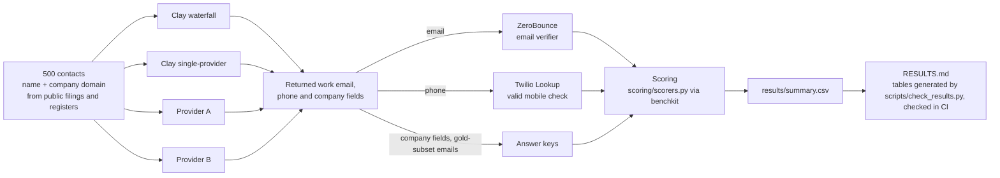

# Enrichment Waterfall Benchmark

[](docs/PREREG.md)
[](RESULTS.md#main-results)
[](#license)
[](.github/workflows/check.yml)

Open benchmark of B2B contact enrichment APIs: does a multi-provider waterfall find more verified work emails than a single-provider database? Clay's default waterfall, Clay limited to one provider, and two anonymized single-database providers (Provider A and Provider B) enrich the same 500 inbound-style records (name + company domain). Every returned email is checked by one independent verifier, and every endpoint is compared on verified emails, working mobiles and cost. Open-source runner and scoring code; the Provider A and B adapters are not published, because their API calls would name the vendors.



Run by [The Prompting Company](https://promptingcompany.com). The method was pre-registered before any counted run ([PREREG.md](docs/PREREG.md)); every change since is in [CHANGELOG.md](docs/CHANGELOG.md). The method and results have not been independently reviewed.

## Contents

This repo is runner and evaluation code only. It doesn't include the input dataset (it contains people's names), run folders or raw vendor responses.

| Path | What it is |
|---|---|
| [RESULTS.md](RESULTS.md) | The results, with tables generated from `results/summary.csv` |
| [METHODOLOGY.md](METHODOLOGY.md) | The pre-registered method |
| [SECURITY.md](SECURITY.md) | How to report a security problem or a data concern privately |
| [LICENSE](LICENSE) | MIT, for the code |
| [CITATION.cff](CITATION.cff) | How to cite this benchmark |
| `bench` | The runner |
| `requirements.txt` | The pinned dependencies |
| `tasks/`, `config/` | The task spec ([tasks/W1-v1.md](tasks/W1-v1.md)) and the frozen config (`config/bench.json`): price date, quality floor and disclosures |
| `providers/`, `scoring/`, `scripts/`, `tests/` | Clay adapters, scoring code, `check_results.py` (published numbers match `results/summary.csv`), `reproduce.sh` (every check in one command) and the tests |
| `results/`, `datasets/` | `summary.csv` (one row per endpoint, every metric and segment cut), `run-plan.json` (frozen config and input checksums), `manifest.json` (hashes of every run file); the industry map and the non-personal answer-key rows |
| [docs/](docs/) | [BENCHMARK-CARD.md](docs/BENCHMARK-CARD.md) (one page: purpose and known limits), [PREREG.md](docs/PREREG.md) (pre-registration record), [ANSWER-KEYS.md](docs/ANSWER-KEYS.md) (how the answer keys were built), [DATA.md](docs/DATA.md) (dataset contract), [DATA-DICTIONARY.md](docs/DATA-DICTIONARY.md) (what every published column means), [PRIVACY.md](docs/PRIVACY.md) (how contact details were used, and how to ask to be removed), [REPRODUCE.md](docs/REPRODUCE.md) (how to check or re-run the benchmark), [REPRODUCTIONS.md](docs/REPRODUCTIONS.md) (log of reproduction attempts), [CHANGELOG.md](docs/CHANGELOG.md) (every change since pre-registration, and the drafts before it), [CONTRIBUTING.md](docs/CONTRIBUTING.md) (how to report an error or send a change), [LICENSE-DOCS](docs/LICENSE-DOCS) (CC BY 4.0, for documentation and results) |

## Task

One task, W1 ([tasks/W1-v1.md](tasks/W1-v1.md)): enrich 500 inbound-style records through the API. For each contact, an endpoint is sent a first name, a last name and a company domain. It must return a work email, a phone number, and the company's name, employee count, industry and HQ country.

Four endpoints run the task. Waterfalls and single databases are kept in separate bands, because they work differently.

| Band | Vendor | Endpoint | What it runs |
|---|---|---|---|
| Waterfall | Clay | `clay_waterfall` | Managed Enrich Company, Work Email (default 11-provider waterfall), Person LinkedIn URL and Mobile Phone Number (default 14-provider waterfall) |
| Single provider | Clay single-provider | `clay_single` | The control arm: the same chain with one provider per field: Findymail for email (with its validation), Forager alone for phone |
| Single provider | Provider B | `provider_b_match` | One match call per contact |
| Single provider | Provider A | `provider_a_enrich` | Company lookup, company enrich (industry, once per company) then contact enrich |

Run `./bench list-providers` for platforms and documentation links. Clay adapter code is in `providers/`; Provider A and B adapters load from `private/providers/`.

## Metrics

Short definitions. The full rules, including how each vendor is asked for phones and how cost is counted, are in [METHODOLOGY.md](METHODOLOGY.md) sections 5 to 7.

- **Verified email rate:** rows whose returned email the shared verifier (ZeroBounce) marks `valid` and that is on the company's domain, out of all 500.
- **Right-person rate (gold subset):** on 100+ contacts whose email is printed on their own company's site or in a filing, the share of returned emails that are exactly that address. Catches deliverable addresses that belong to someone else.
- **Email fill rate:** rows with any email returned, out of 500.
- **Valid mobile rate:** rows whose returned phone the shared phone checker (Twilio Lookup, line type) confirms is a valid **mobile** number, out of 500.
- **Firmographic accuracy:** answer-key rows where employee band, industry and country all match, out of the answer-key rows that have all three (each field is also reported on its own). A blank counts as a miss. Vendor industry labels are mapped to 15 shared industries first ([datasets/industry-map.csv](datasets/industry-map.csv)).
- **$ / 1k verified:** run usage × marginal unit price ÷ verified emails × 1,000.
- **Latency:** client-observed time per contact to the email result (for Clay, wall time from starting its company and email routines to their results, to within one 30-second poll; phone steps aren't counted for any vendor).

## Fixed protocol

- The same 500-row input file for every endpoint. Its checksum is frozen with `bench freeze`, and runs with a different input are refused.
- One enrichment request per contact per endpoint, with the same input every time. Only rate limits (429), server errors (5xx) and no-response failures are retried, up to 3 attempts in total; every other failure is final. No manual lookups.
- Paid work is never repeated: each result is saved as it arrives, and Clay routine runs already started are polled, not restarted, when a run resumes.
- Default settings. The control arm's single provider is named before freezing.
- Blank, not guessed. A pattern-guessed email counts only if the verifier accepts it, the same as any other.
- One run per vendor account at a time, so credit balances can be read before and after.
- Credentials are redacted before HTTP audit files are written. `bench audit` fails if any survive.

## Results

Clay's waterfall found the most verified work emails (59% of 500 contacts) and the most working mobiles (69%).

Full results, including cost and latency, are in [RESULTS.md](RESULTS.md) and `results/summary.csv`.

## Setup

```bash
python3 -m venv .venv && .venv/bin/pip install -r requirements.txt
source .venv/bin/activate
python -I -m unittest discover -s tests
cp .env.example .env
```

Fill in only the credentials for the endpoints you run. Provider A uses its own command-line client's browser login.

## Run it

The full run sequence (freeze, smoke test, runs, usage, verify, score and the publishing checks) is in [REPRODUCE.md](docs/REPRODUCE.md), section B.
[DATA.md](docs/DATA.md) has the dataset contract, the output layout and what's published.

## Reproduce it

```bash
scripts/reproduce.sh
```

One command for every check that needs no vendor account: it sets up `.venv`, runs the tests, checks the published numbers against `results/summary.csv` and checks that `results/` holds no email addresses (vendor names are checked by a CI step with a private list). With our private run folders in `private/runs/` it also re-scores every run and fails if the rebuilt `summary.csv` differs from the committed one.

Step-by-step for someone with no prior context, including how to re-run the benchmark on a fresh sample: [REPRODUCE.md](docs/REPRODUCE.md). Attempts so far are logged in [REPRODUCTIONS.md](docs/REPRODUCTIONS.md); to add yours, open a "Reproduction report" issue.

## Related benchmarks

- **AI pre-call briefs:** how well an AI agent writes pre-call research briefs using one data platform's own tools, on Clay and two anonymized data providers: [clay-precall-briefs-benchmark](https://github.com/promptingcompany/clay-precall-briefs-benchmark)
- **Shared harness:** [benchkit](https://github.com/heterochromatic/benchkit)

## License

- **Code:** MIT ([LICENSE](LICENSE)).
- **Documentation and results** (every `.md` file, `results/` and `datasets/public/`): [CC BY 4.0](https://creativecommons.org/licenses/by/4.0/) ([LICENSE-DOCS](docs/LICENSE-DOCS)). Credit The Prompting Company.
